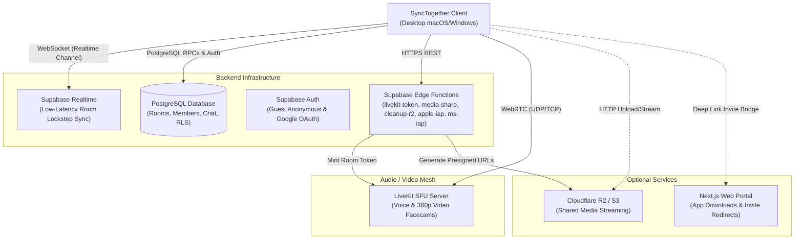

# Self-Hosting SyncTogether

This guide provides complete instructions for self-hosting your own SyncTogether infrastructure - from running on a local home server to deploying a high-availability production instance on a VPS or cloud provider.

---

> [!TIP]
> **Two scripts do most of the work.** `python3 scripts/selfhost-setup.py` is a guided wizard: it asks for your details and addresses, writes every config file and prints the commands left to run for your choices (Section 4). `python3 scripts/selfhost-verify.py` then checks the finished deployment against your real servers and says whether it is ready (Step 7). The rest of this guide explains what they automate, so you can also do any step by hand.

## 1. System Architecture

SyncTogether consists of four modular layers designed for low latency, secure room state synchronization, and SFU-routed AV facecams (LiveKit relays media; clients never connect peer-to-peer):



---

## 2. Choosing Your Deployment Path

| Method | Complexity | Infrastructure Requirements | Best For |
|---|---|---|---|
| **Path A: Managed Hybrid** *(Recommended)* | 🟢 Easy (~5 mins) | Free accounts on [Supabase](https://supabase.com) and [LiveKit Cloud](https://livekit.io) | Personal use, small friend groups, fast onboarding with zero server maintenance |
| **Path B: Fully Self-Hosted (Docker)** | 🟡 Intermediate | VPS or home server with Docker, Docker Compose, public IP or domain with TLS | Complete data ownership, private networks, offline LAN parties |

---

## 3. Prerequisites

Before starting, ensure you have the following installed on your machine:

1. **[FVM](https://fvm.app)** (Flutter Version Management) or **Flutter SDK 3.44.8** (pinned in `.fvmrc`):
   ```bash
   dart pub global activate fvm
   fvm install
   ```
2. **[Supabase CLI](https://supabase.com/docs/guides/cli)** (v2.x+):
   ```bash
   # macOS / Linux (Homebrew)
   brew install supabase/tap/supabase
   
   # Windows (Scoop)
   scoop bucket add supabase https://github.com/supabase/scoop-bucket.git
   scoop install supabase
   ```
3. **[Docker & Docker Compose](https://docs.docker.com/get-docker/)** (Required for local development and self-hosted LiveKit/Supabase).
4. **[Node.js 20+]** (Required if building/running the Next.js web portal).

---

## 4. Step-by-Step Setup Guide

> [!TIP]
> **Quick start: let the wizard do the typing.** `python3 scripts/selfhost-setup.py` asks for everything the steps below need - who you are (the legal pages name the operator), your addresses, sign-in, voice/video and file-storage choices - then writes `.env`, `supabase/.env`, `supabase/functions/.env` and `website/.env.local` for you (all private and git-ignored), generates your auth config, and prints the exact commands left to run, in order, for your answers. It is safe to re-run: earlier answers become the defaults, and a changed file is backed up first. It writes files only; it touches no server. The steps below are what it automates, so you can do any of them by hand. **Read the legal pages before you publish** - see Step 6.

### Step 1: Database & Backend (Supabase)

#### Option 1: Managed Supabase Cloud (Easiest)
1. Create a free project at [database.new](https://database.new).
2. Note your **Project URL** (`https://<project-ref>.supabase.co`) and **Publishable (anon) Key** from **Project Settings → API**.
3. Link your local repository to the project:
   ```bash
   supabase login
   supabase link --project-ref <project-ref>
   ```
4. Push all database migrations, RLS policies, stored procedures, and cron sweep jobs:
   ```bash
   supabase db push
   ```

#### Option 2: Self-Hosted Supabase Docker Stack
If self-hosting the full Supabase container stack on your own server:
1. Follow the official [Supabase Self-Hosting Guide with Docker](https://supabase.com/docs/guides/self-hosting/docker).
2. Once the container stack is active (the self-hosted Kong gateway listens on `http://<host>:8000` by default - put TLS in front of it, e.g. `https://api.yourdomain.com`; `54321` is only the Supabase CLI's local dev port), apply the SyncTogether schema:
   ```bash
   supabase db push --db-url "postgresql://postgres:<your-db-password>@<db-host>:5432/postgres"
   ```
3. The migrations schedule jobs with `pg_cron` and call Edge Functions with `pg_net`; both extensions ship in the official Supabase images, but confirm they are enabled if you run a custom Postgres.

---

### Step 2: Audio & Video Facecam Server (LiveKit)

SyncTogether uses LiveKit for ultra-low-latency voice and video facecam rails.

#### Option 1: LiveKit Cloud (Easiest)
1. Sign up for a free project at [cloud.livekit.io](https://cloud.livekit.io).
2. Retrieve your **WebSocket URL** (`wss://<your-subdomain>.livekit.cloud`), **API Key**, and **API Secret** from **Settings → Keys**.

#### Option 2: Self-Hosted LiveKit Server (Docker)
1. A ready-to-use Docker Compose setup is included in the repo (`docker-compose.selfhost.yml` + `docker/livekit.yaml`, LiveKit pinned to `v1.13`). No API key is stored in the repo and the compose file **refuses to start without one** - generate a pair and keep it, you will paste the same two values into `supabase/functions/.env`:
   ```bash
   export LIVEKIT_API_KEY="API$(openssl rand -hex 6)"
   export LIVEKIT_API_SECRET="$(openssl rand -base64 36 | tr -d '/+=')"
   ```
   `docker/livekit.yaml` ships `use_external_ip: false`, which only works on a LAN; set it to `true` on a public VPS (or use Option 3, which does this and more).
2. Start the LiveKit server:
   ```bash
   docker compose -f docker-compose.selfhost.yml up -d
   ```
3. Ensure the following firewall ports are open on your server:
   - `7880/TCP`: HTTP / WebSocket signaling
   - `7881/TCP`: WebRTC TCP fallback
   - `50000-50100/UDP`: WebRTC media streams
4. Clients connect over `wss://`, so terminate TLS for port 7880 behind a reverse proxy (Caddy, nginx, Traefik) on a domain such as `livekit.yourdomain.com`.

The steps above suit a LAN or a quick test. For a public server, use Option 3.

#### Option 3: Self-Hosted LiveKit on a VPS (production)

`scripts/setup-livekit-server.sh` turns a fresh Ubuntu VPS (x86_64 or ARM) into a production LiveKit server: Docker, LiveKit on host networking, Caddy with an automatic TLS certificate, host firewall rules, and freshly generated API keys. It is safe to re-run; existing keys are kept.

**Ports to allow in your cloud firewall**

| Port | Protocol | Purpose |
|---|---|---|
| 22 | TCP | SSH |
| 80, 443 | TCP | TLS certificate and `wss://` signalling (Caddy) |
| 7881 | TCP | WebRTC over TCP, for networks that block UDP |
| 7882 | UDP | WebRTC media |
| 3478 | UDP | TURN |
| 30000-40000 | UDP | TURN relay range |

**Run it**

1. Point a DNS `A` record (e.g. `av.yourdomain.com`) at the server's public IP. If your DNS is on Cloudflare, leave it **DNS only** (grey cloud): Cloudflare's proxy does not carry WebRTC.
2. On the server:
   ```bash
   git clone https://github.com/<you>/synctogether.git && cd synctogether
   sudo ./scripts/setup-livekit-server.sh av.yourdomain.com
   ```
3. The script prints an endpoint entry. Add it to `LIVEKIT_ENDPOINTS` in `supabase/functions/.env`, then run `supabase secrets set --env-file supabase/functions/.env`. List it first to make it the preferred endpoint, with any LiveKit Cloud project after it as a fallback.
4. Updating later: `docker compose -f deploy/livekit/docker-compose.yml up -d --pull always`.

**Notes for Oracle Cloud's Always Free tier**

An Ampere A1 VM (up to 4 OCPU / 24 GB, 10 TB egress a month) runs this comfortably at no cost.

- **Shape:** `VM.Standard.A1.Flex`, image Ubuntu 24.04 (aarch64). 2 OCPU / 12 GB is plenty. If the console reports *Out of host capacity*, try another availability domain or retry later.
- **Public IP:** reserve one (Networking → Reserved public IPs) and attach it, so the DNS record survives a stop/start.
- **Cloud firewall:** add the port table above as ingress rules on the subnet's security list (Networking → Virtual cloud networks → your VCN → Security lists). Oracle's Ubuntu image also has an `iptables` REJECT rule of its own; the script opens the same ports there. A server that is "configured correctly" but unreachable is almost always that rule.
- **Idle reclamation:** Oracle may reclaim an Always Free VM whose CPU, network and memory use all stay low for 7 days, which is a quiet AV server's normal state. Upgrading the account to Pay As You Go keeps the Always Free allowances at no charge and stops reclamation. Set a budget alert (Billing → Budgets) at a small amount so a misconfiguration can never cost you silently.

---

### Step 3: Deploy Backend Edge Functions

SyncTogether uses Supabase Edge Functions to mint short-lived LiveKit JWT access tokens and manage media sharing.

1. Copy `supabase/functions/.env.example` to `supabase/functions/.env` and fill in at least:
   ```bash
   LIVEKIT_API_KEY=<your-livekit-api-key>
   LIVEKIT_API_SECRET=<your-livekit-api-secret>
   LIVEKIT_URL=<your-livekit-websocket-url>
   ```
2. Upload the secrets, then deploy:
   ```bash
   supabase secrets set --env-file supabase/functions/.env

   # LiveKit token minter (required for voice/video facecams)
   supabase functions deploy livekit-token
   # Mirrors room end/kick onto every LiveKit endpoint (set app_settings.av_cleanup.endpoint_url to enable)
   supabase functions deploy av-cleanup
   ```

*(Optional)* Media file sharing via Cloudflare R2 (or any S3-compatible store) - set the four `CF_R2_*` secrets first:
```bash
supabase functions deploy media-share
supabase functions deploy cleanup-r2
```

> [!IMPORTANT]
> **R2 cleanup ships switched off.** The 5-minute cron calls `invoke_r2_cleanup()`, which does nothing until you tell it where `cleanup-r2` lives. Without this, deleted and expired shared videos are never removed from your bucket:
> ```sql
> update public.app_settings
>    set value = jsonb_build_object(
>      'enabled', true,
>      'endpoint_url', 'https://<your-supabase-host>/functions/v1/cleanup-r2',
>      'service_role_key', '<your-service-role-key>')
>  where key = 'r2_cleanup';
> ```

> [!TIP]
> **Optional: faster streaming with the edge Worker.** Members stream the host's file from your bucket's S3 endpoint, which is neither CDN-cached nor close to them. `deploy/media-edge/` is a small Cloudflare Worker that reads the same bucket through an R2 *binding* (no S3 keys in it), honours HTTP Range and caches 4 MiB chunks at the edge so the 2nd..Nth viewer never reaches R2. It never alters the file. `deploy/media-edge/wrangler.toml` ships the official deployment's hostname - change the `[[routes]]` pattern to your own zone first. It needs a Cloudflare account, a hostname on a zone you own and Workers Paid for a busy room (the Free plan's 10 ms CPU and 50-subrequest limits are tight). If you skip it nothing changes: with `MEDIA_EDGE_SECRET` unset or `app_settings.media_edge.enabled = false`, `download-url` returns the presigned S3 URL exactly as before. Setup and rollback: [media-edge.md](media-edge.md).

### Push notifications (optional)

Pairing, date-night reminders and "is calling" use push. The database queues what to send (`push_outbox`, with per-person switches and quiet hours in the recipient's own time zone) and the `push-dispatch` function delivers it. Everything is optional and each platform stands alone: set only the secrets for the platforms you ship (see `supabase/functions/.env.example`: `APNS_*` for iOS and macOS, `FCM_SERVICE_ACCOUNT` for Android, `WNS_PACKAGE_SID` / `WNS_CLIENT_SECRET` for Windows), deploy the function, then point the database at it:

```sql
update public.app_settings set value = jsonb_build_object('enabled', true,
  'endpoint_url', 'https://<your-supabase-host>/functions/v1/push-dispatch',
  'service_role_key', '<your-service-role-key>') where key = 'push';
```

```bash
supabase functions deploy push-dispatch
```

**Set the provider secrets first and the endpoint last:** a push for a platform with no credentials is skipped and dropped, not retried, so enabling the endpoint before the secrets discards whatever was queued. Until `endpoint_url` is set nothing is delivered and nothing fails; the queue is pruned after two days. The Android client also needs `FIREBASE_API_KEY`, `FIREBASE_APP_ID`, `FIREBASE_PROJECT_ID` and `FIREBASE_SENDER_ID` as `--dart-define`s, and an iOS or macOS build needs the Push Notifications capability and an `aps-environment` entitlement.

`apple-iap` is only needed if you sell Premium through the Mac App Store (secrets `APPLE_BUNDLE_ID`, `APPLE_APP_APPLE_ID`); a self-hosted instance can skip it. `ms-iap` is the Microsoft Store equivalent (secrets `MS_STORE_TENANT_ID`, `MS_STORE_CLIENT_ID`, `MS_STORE_CLIENT_SECRET`, `MS_STORE_PRODUCT_IDS`), also optional.

---

### Step 4: Authentication Configuration

All auth settings live in `supabase/config.toml`, with secrets read from `supabase/.env` (copy `supabase/.env.example`). Push them with:
```bash
supabase config push
```
Auth config is **not** part of `supabase db push` - a migrated database with un-pushed auth config will fail in confusing ways.

> [!IMPORTANT]
> **Do not push `supabase/config.toml` as it is.** It is the official deployment's config: redirect allow-list for `synctogether.app`, Turnstile on, Google and Apple on with the official bundle ids. Generate your own copy instead (the tracked file is left alone; output goes to the gitignored `.selfhost/`):
> ```bash
> ./scripts/selfhost-config.sh https://watch.example.com [--no-captcha] [--google] [--apple]
> (cd .selfhost && supabase config push --project-ref <your-ref>)   # run it from inside .selfhost; --workdir is ignored by config push
> ```
> Create `supabase/.env` first (it supplies the OAuth and captcha secrets; the script links it in, and warns if it is missing, because a push without it sends empty secrets). `--no-captcha` skips Turnstile, `--google` / `--apple` keep those providers (both are off by default). On a self-hosted Docker stack `config push` does not apply: run `./scripts/selfhost-config.sh https://watch.example.com --gotrue` and paste the printed `GOTRUE_*` variables into that stack's `.env`.

The numbered list below describes what the settings mean; the script already applies the site URL, redirects, captcha and provider toggles.

1. **Anonymous Guest Sign-in**: Enabled (`enable_anonymous_sign_ins = true`). Guests receive a temporary username (`Guest-xxxx`) and are purged after 3 days.
   - **Cloudflare Turnstile is required as shipped**: `[auth.captcha]` is `enabled = true`, so the server rejects any guest sign-in without a token. Either create a Turnstile widget (add `localhost` to its hostname allow-list - the client serves the challenge from a loopback page), set `SUPABASE_AUTH_CAPTCHA_SECRET` in `supabase/.env` and build the client with `TURNSTILE_SITE_KEY`, **or** pass `--no-captcha` to the config script.
2. **Google OAuth (Optional)**:
   - In Google Cloud Console, create a **Web Application OAuth Client** with the Authorized Redirect URI `https://<your-supabase-host>/auth/v1/callback`.
   - Put the ID and secret in `supabase/.env` as `SUPABASE_AUTH_EXTERNAL_GOOGLE_CLIENT_ID` / `SUPABASE_AUTH_EXTERNAL_GOOGLE_SECRET`.
   - Keep `enable_manual_linking = true` - it is what lets a guest upgrade to Google in place; with it off every upgrade fails with `manual_linking_disabled`.
   - `site_url` and `additional_redirect_urls` are set to your portal's origin by the config script; a plain `config.toml` push would leave them on `synctogether.app`.
3. **Apple Sign-In (Optional)**: `[auth.external.apple]` lists the Services ID and bundle id (`app.synctogether.web,app.synctogether`) - change them to your own identifiers and set `SUPABASE_AUTH_EXTERNAL_APPLE_SECRET` (a 6-month ES256 JWT from your `.p8` key).
4. **Email OTP (Optional)**: Email sign-in sends a 6-digit code using the template in `supabase/templates/magic_link.html`. Configure an SMTP provider (`[auth.email.smtp]`) for production - Supabase's built-in sender is heavily rate-limited.

---

### Step 5: Configure and Build Client Applications

> [!NOTE]
> **Platform Support**: Desktop builds officially target **macOS** and **Windows**. Linux desktop is currently unsupported due to upstream WebView limitations.

SyncTogether uses Flutter compile-time defines (`--dart-define`) to bake configuration directly into the compiled client binary. This ensures no plaintext credentials or `.env` files are bundled into distributed release packages.

#### Option A: Local Offline Development (Zero-Config)
If testing locally with the local Supabase stack (`./scripts/dev.sh`), no flags are needed. In debug mode, the client automatically defaults to `http://127.0.0.1:54321` and local development keys:
```bash
# Fetch dependencies
fvm flutter pub get

# Run on macOS or Windows
fvm flutter run -d macos
```

#### Option B: Connecting to Your Self-Hosted Cloud or VPS Instance
Provide your self-hosted endpoints via `--dart-define`:

```bash
# Fetch Flutter packages
fvm flutter pub get

# Run in debug mode pointing to your self-hosted backend:
fvm flutter run -d macos \
  --dart-define=SUPABASE_URL="https://<your-supabase-url>" \
  --dart-define=SUPABASE_PUBLISHABLE_KEY="<your-supabase-publishable-key>" \
  --dart-define=LIVEKIT_URL="wss://<your-livekit-url>" \
  --dart-define=SITE_URL="https://<your-web-portal>" \
  --dart-define=SUPPORT_EMAIL="<you@your-domain>"

# Build release binaries:
fvm flutter build macos --release \
  --dart-define=SUPABASE_URL="https://<your-supabase-url>" \
  --dart-define=SUPABASE_PUBLISHABLE_KEY="<your-supabase-publishable-key>" \
  --dart-define=LIVEKIT_URL="wss://<your-livekit-url>" \
  --dart-define=SITE_URL="https://<your-web-portal>" \
  --dart-define=SUPPORT_EMAIL="<you@your-domain>"

fvm flutter build windows --release \
  --dart-define=SUPABASE_URL="https://<your-supabase-url>" \
  --dart-define=SUPABASE_PUBLISHABLE_KEY="<your-supabase-publishable-key>" \
  --dart-define=LIVEKIT_URL="wss://<your-livekit-url>" \
  --dart-define=SITE_URL="https://<your-web-portal>" \
  --dart-define=SUPPORT_EMAIL="<you@your-domain>"
```

> [!IMPORTANT]
> **`SITE_URL` and `SUPPORT_EMAIL` have no built-in values - set both.** `--dart-define=SITE_URL=https://watch.example.com` is the origin of your web portal (Step 6); the client builds invite links (`/join/<code>`), recap and profile links, the Terms/Privacy links and the Google sign-in bridge (`/auth/desktop-callback`) from it. `--dart-define=SUPPORT_EMAIL=help@example.com` is where reports and appeals point. Nothing falls back to the official site, so a build can never send your users' invites or sign-ins through someone else's. Left unset the client still runs, but invites share the `synctogether://join/<code>` link instead, the Terms/Privacy and share-link buttons disappear and Google sign-in says it isn't set up. The verifier in Step 7 fails a release configuration without them.

> [!TIP]
> **One file for all the defines.** Copy `.env.example` to `.env`, fill in your values, and build with `--dart-define-from-file=.env` instead of repeating each `--dart-define`. It lists every client define (`SUPABASE_URL`, `SUPABASE_PUBLISHABLE_KEY`, `SITE_URL`, `SUPPORT_EMAIL`, `LIVEKIT_URL`, `TURNSTILE_SITE_KEY`, telemetry) with what each is for, and the Step 7 verifier reads the same file, so what you verify is what you ship. It is also what VS Code's `.vscode/launch.json` `args` can point at. Client-safe values only; never put server secrets in it.

---

### Step 6: Deploy Web Portal (`website/`)

The web portal (`website/`) provides the Terms and Privacy pages, shareable invite pages (`<SITE_URL>/join/<code>` hands the code to the app via the `synctogether://join/<code>` deep link), recap and profile pages, the Google sign-in bridge, and the marketing and download pages. Deploy it at the origin you pass as `SITE_URL`.

1. Navigate to the website directory:
   ```bash
   cd website
   cp .env.example .env.local
   npm install
   ```
2. Set `NEXT_PUBLIC_SUPABASE_URL`, `NEXT_PUBLIC_SUPABASE_PUBLISHABLE_KEY`, `SUPABASE_SERVICE_ROLE_KEY`, `NEXT_PUBLIC_SITE_URL`, `NEXT_PUBLIC_SUPPORT_EMAIL` and `NEXT_PUBLIC_COPYRIGHT_EMAIL` in `website/.env.local`. **A production build refuses to start without the site URL and the two addresses** - there are no built-in values, so a build can never serve someone else's contacts. Set `NEXT_PUBLIC_OPERATOR_NAME`, `NEXT_PUBLIC_OPERATOR_ADDRESS` (lines separated by `|`) and `NEXT_PUBLIC_GOVERNING_LAW` too: the Terms, Privacy and DMCA pages name the operator, and a production build refuses to start without them. Optional: `NEXT_PUBLIC_OPERATOR_URL`, `NEXT_PUBLIC_OPERATOR_TWITTER`, `NEXT_PUBLIC_APP_STORE_URL`, `NEXT_PUBLIC_MICROSOFT_STORE_URL`, and `NEXT_PUBLIC_DMCA_REGISTRATION` (leave it empty unless you registered an agent with the U.S. Copyright Office - the DMCA page only claims a registered agent when it is set). **The wizard fills in your details, not the legal text around them:** the Terms and Privacy pages are written for the project's own deployment. Have a lawyer review them, in particular the list of service providers in `website/app/privacy/page.tsx` (yours will differ) and the India (DPDP Act) section. PostHog and the `PROD_*` variables are optional: `PROD_SUPABASE_*` only feed the internal `/internal/metrics` page, which you can ignore; see `website/.env.example` for the full list.
3. Run or deploy:
   ```bash
   # Development
   npm run dev

   # Production build
   npm run build
   npm run start
   ```

---

### Step 7: Verify the deployment

*(The setup wizard, `scripts/selfhost-setup.py`, offers to run this for you at its end and prints the right `--require` flags for your choices.)*

Do not trust a setup because each step printed no error. `scripts/selfhost-verify.py` checks the whole thing against your real servers - not just that values are set, but that they work together:

```bash
export SUPABASE_SERVICE_ROLE_KEY=...          # from Project Settings -> API; used only by the script
python3 scripts/selfhost-verify.py            # reads ./.env (client defines) and supabase/functions/.env
python3 scripts/selfhost-verify.py --require av,media     # a feature you intend to run must work, not just be "off"
```

Use the same values you build the client with: put the client defines (`SUPABASE_URL`, `SUPABASE_PUBLISHABLE_KEY`, `SITE_URL`, `SUPPORT_EMAIL`, `LIVEKIT_URL`, `TURNSTILE_SITE_KEY`) in a `KEY=VALUE` file and pass it with `--client-env`. Python 3 only, nothing to install.

It signs in a throwaway test user (through the admin API, so no email or captcha is involved) and then:

| Area | What it proves |
|---|---|
| Config | client and server agree (LiveKit on both sides or neither, R2 all-or-none), no shipped dev keys, `SITE_URL`/`SUPPORT_EMAIL` set |
| Backend | auth reachable, keys valid, every table from `supabase/migrations` exists, `tier_limits` and `app_settings` seeded |
| Auth | guest and email sign-in enabled, captcha setting matches the client's Turnstile key, your site's redirect URLs are on the allow-list |
| Rooms | `create_room` works, RLS blocks anonymous reads, a member joins the **private Realtime channel** |
| Functions | all functions deployed; LiveKit **accepts the token** your `livekit-token` mints; a file uploaded through `media-share` lands in your bucket and streams back byte-identical; `av_cleanup` / `r2_cleanup` are switched on |
| Cron | an expired room is ended by the every-minute job (about 2 minutes), the only direct proof `pg_cron` is running |
| Web | your `SITE_URL` serves the home, terms, privacy and invite pages and the sign-in bridge |

Everything it creates (user, room, uploaded file) is removed afterwards. The result is one of:

- **READY** (exit 0): every automated check passed.
- **NOT READY** (exit 1): the list says what failed and the command to fix it. Fix it and run again.
- **INCOMPLETE** (exit 2): a check could not run (for example `--skip-cron-wait`), so nothing is promised.

**What READY does not cover.** Five things need a person, and the script prints them every time: an email code arriving in a real inbox (SMTP), Google sign-in end to end, two machines actually hearing and seeing each other (UDP through your firewall), a release build run once with these same defines, and your own backups and certificate renewal. Features you have not configured are shown as *off*, not as passing; use `--require` to make them failures. Run it again after every upgrade (`supabase db push`, a new function deploy, a LiveKit change).

---

## 5. Environment Variables Reference

### Client Configuration (`--dart-define`)

Pass these variables at compile-time via `--dart-define=KEY=VALUE` or `--dart-define-from-file`:

| Variable | Required? | Description |
|---|---|---|
| `SUPABASE_URL` | **Yes** (Release) | Public HTTPS endpoint of your Supabase API gateway (defaults to `http://127.0.0.1:54321` in debug mode) |
| `SUPABASE_PUBLISHABLE_KEY` | **Yes** (Release) | Supabase publishable API key (defaults to local development key in debug mode) |
| `LIVEKIT_URL` | *No* | LiveKit WebSocket endpoint (`wss://...`). Facecam rails are hidden if unset |
| `SITE_URL` | **Yes** (Release) | Origin of your web portal (invites, recaps, profile pages, Terms/Privacy, Google sign-in bridge). No built-in default; a debug run on the local stack always uses `http://localhost:3000` |
| `SUPPORT_EMAIL` | **Yes** (Release) | Address shown in report/appeal copy. No built-in default; unset hides the "email us" lines |
| `TURNSTILE_SITE_KEY` | *No* | Cloudflare Turnstile site key for captcha verification |
| `SENTRY_DSN` | *No* | Sentry project DSN for client-side crash telemetry |
| `POSTHOG_API_KEY` | *No* | PostHog public project key for product analytics |
| `POSTHOG_HOST` | *No* | PostHog ingest host (defaults to `https://us.i.posthog.com`) |
| `SUPABASE_URL_LOCAL` / `SUPABASE_PUBLISHABLE_KEY_LOCAL` | *No* | Debug builds only: preferred over `SUPABASE_URL` so a debug run never touches production. Ignored in release |

In debug builds with no local values set, the client falls back to `http://127.0.0.1:54321` and Turnstile's always-pass test key. **A release build with no `SUPABASE_URL` has no backend at all** - always pass it.

### Edge Functions Secrets (`supabase/functions/.env`)

| Variable | Required? | Description |
|---|---|---|
| `LIVEKIT_API_KEY` | **Yes** *(for AV)* | LiveKit API Key (matches key in `livekit.yaml` or LiveKit Cloud) |
| `LIVEKIT_API_SECRET` | **Yes** *(for AV)* | LiveKit API Secret (used by edge function to sign JWT tokens) |
| `LIVEKIT_URL` | **Yes** *(for AV)* | LiveKit WebSocket URL |
| `LIVEKIT_ENDPOINTS` | *No* | JSON array of `{id, url, key, secret, trial?}` LiveKit endpoints in priority order; replaces the three above. `trial` (default: on unless the URL is `*.livekit.cloud`) allows the free tier's video trial there. Rooms fail over between them (see `docs/feature-toggles.md`) |
| `LIVEKIT_TRIAL` | *No* | Single-endpoint override for the free tier's video trial (default: on unless the URL is `*.livekit.cloud`) |
| `AV_DEBUG_SWITCHING` | *No* | Local/staging only, never production: lets debug builds switch AV endpoints by hand |
| `CF_R2_ENDPOINT` | *No* | Cloudflare R2 / S3 S3-compatible endpoint for media sharing |
| `CF_R2_ACCESS_KEY_ID` | *No* | Cloudflare R2 / S3 access key |
| `CF_R2_SECRET_ACCESS_KEY` | *No* | Cloudflare R2 / S3 secret key |
| `CF_R2_BUCKET_NAME` | *No* | Cloudflare R2 bucket name |
| `MEDIA_EDGE_SECRET` | *No* | HMAC secret shared with the optional media-edge Worker (see below). Unset = presigned S3 URLs, as before |
| `APPLE_BUNDLE_ID` / `APPLE_APP_APPLE_ID` | *No* | Only for the `apple-iap` function (Mac App Store purchases) |
| `MS_STORE_TENANT_ID` / `MS_STORE_CLIENT_ID` / `MS_STORE_CLIENT_SECRET` / `MS_STORE_PRODUCT_IDS` | *No* | Only for the `ms-iap` function (Microsoft Store purchases) |
| `APNS_*` / `FCM_SERVICE_ACCOUNT` / `WNS_PACKAGE_SID` + `WNS_CLIENT_SECRET` | *No* | Only for the `push-dispatch` function, one set per platform you ship |

`SUPABASE_URL`, `SUPABASE_ANON_KEY` and `SUPABASE_SERVICE_ROLE_KEY` are injected into Edge Functions by Supabase automatically; don't set them yourself.

### Auth Secrets (`supabase/.env`, used by `supabase config push`)

| Variable | Required? | Description |
|---|---|---|
| `SUPABASE_AUTH_CAPTCHA_SECRET` | **Yes**, unless captcha is disabled | Cloudflare Turnstile secret key |
| `SUPABASE_AUTH_EXTERNAL_GOOGLE_CLIENT_ID` / `_SECRET` | *No* | Google OAuth client |
| `SUPABASE_AUTH_EXTERNAL_APPLE_SECRET` | *No* | Apple Sign-In client secret JWT |

### Tuning Limits

Room sizes, session lengths, AV level, media-sharing quotas and reward thresholds are database rows (`tier_limits`, `app_settings`, `reward_config`), not code - change them with an `update`. See [feature-toggles.md](feature-toggles.md) for every key.

---

## 6. Maintenance & Troubleshooting

### Database Resets & Migration Updates
When pulling updates from the upstream repository:
```bash
# Check status and apply any new migrations
supabase db push
```

### Checking Edge Functions Logs
The Supabase CLI has no log-tailing command for deployed functions. On Supabase Cloud use **Dashboard → Edge Functions → <function> → Logs**; on a self-hosted stack read the functions container (`docker logs -f supabase-edge-functions`). Locally, `supabase functions serve` prints logs to the terminal.

### Secrets Backup and Recovery (`scripts/secrets.sh`)
Packs every local secret file (`.env` files, certificates, keys) into one encrypted bundle and restores them to their original paths:
```bash
# Encrypt and package all repository secrets into a safe backup bundle
./scripts/secrets.sh pack

# List files included in a secrets bundle
./scripts/secrets.sh list

# Restore secret files into their exact paths with appropriate permissions
./scripts/secrets.sh unpack synctogether-secrets-bundle.txt
```

### Testing Connectivity Locally
To test the complete stack locally with automated hot reloading:
```bash
./scripts/dev.sh
```

---

## 7. License & Commercial Notice
 
SyncTogether is licensed under the **PolyForm Noncommercial License 1.0.0 (PolyForm-Noncommercial-1.0.0)**.
 
- **Permitted**: You are 100% free to self-host, run, inspect, and modify SyncTogether for yourself, your family, your community, or non-commercial/educational purposes.
- **Prohibited**: You may not sell SyncTogether, offer it as a commercial hosted service (SaaS), or use it for commercial organizational purposes without an explicit commercial license.
- See the [LICENSE](../LICENSE) file for complete legal terms.
